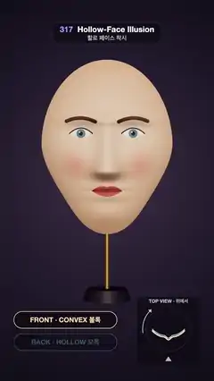

# 317 · Hollow-Face Illusion · 할로 페이스 착시



**EN** A painted plaster mask turns steadily on a rod; when its hollow inside faces us it still reads as a face bulging out and seems to turn the wrong way.  
**KO** 색칠한 석고 가면이 막대 위에서 일정하게 돈다. 오목한 안쪽이 우리를 향해도 여전히 볼록한 얼굴로 보이고, 반대 방향으로 도는 것처럼 보인다.

[Video (mp4)](https://sueun-dev.github.io/motion-effects/videos/317-hollow-face.mp4) · [Code](../effects/317-hollow-face.js) · Classic optical illusions · 고전 착시

## Prompt (English)

```text
Create a "Hollow-Face Illusion" motion effect: a mask turns once; when its hollow inside faces the camera it still looks like a convex face, turning the wrong way. A plan view shows the truth.

Look
- The mask: one height field over an egg-shaped outline (half-widths 0.92 × 1.22, narrowing by 24 % toward the chin): a dome z = 0.62 · √(1 − 0.78 r²) − 0.3 plus Gaussian features — a nose ridge growing to 0.3 at the tip (y = −0.32), nostril wings, eye sockets −0.13 at (±0.36, 0.2) with eyeballs under the lids, cheekbones, a brow ridge, upper and lower lips with a groove between them, a chin.
- Painted on both sides alike: skin #F0CDB0 → #D9A887, blush, brown brows #5A3A2A, open almond eyes with blue-grey irises #4C7A93, red lips #B9584A. The inside surface sits 0.05 behind the front; a plaster rim #EDE4D8 joins them.
- It stands on a brass rod over a small dark base, against a dark plum radial gradient #3B2F45 → #0D0B12.
- Camera: 20° field of view at (0, 0.35, 15) looking at (0, −0.35, 0). One soft key light #FFF3E6 just above the camera (0.6, 2.2, 10), a warm hemisphere fill, no shadows (they would give the hollow away).
- Overlay: pills FRONT · CONVEX 볼록 and BACK · HOLLOW 오목, each lit by how much its side faces us; a plan view in the corner (TOP VIEW · 위에서) with the camera, the mask's horizontal section (gold = convex face, blue = hollow side) turning, and an arrow for the real direction of turn.

Motion (0–5 s)
- The mask and rod turn one full turn at a steady speed, −2π · t / 5 (clockwise seen from above). Nothing else moves.
- While the front faces us it is a normal face turning one way; as the hollow side comes round, the face seems to bulge out again and turn the other way.

Technique
- three.js. A polar grid (90 rings × 220 spokes) evaluates the height field; the front surface and a copy 0.05 behind it (reversed winding) share one canvas paint texture mapped over the outline's bounding box; normals from computeVertexNormals.
- MeshStandardMaterial, roughness 0.62, ACES Filmic tone mapping. The plan view's section is the same height function sampled at eye height and rotated by the same angle.

Output and rules
- One self-contained HTML file with no external assets (three.js from a CDN is fine if you use it), drawing on a 1080 × 1920 canvas (9:16) scaled to fit the window.
- Write a function renderFrame(t) that draws the frame for time t in seconds, and preview it with requestAnimationFrame. Everything must be a pure function of t and fixed seeds: no Math.random(), Date or state carried between frames, so frame i = renderFrame(i / 30) can be exported to a 30 fps video.
- Loop seamlessly every 5 seconds: renderFrame(5) must look exactly like renderFrame(0).
- No flicker of any kind: no noise or grain that changes from frame to frame, no strobing or blinking, no z-fighting, no shimmering 1 px lines. Any grain or texture stays fixed to the screen or to the object.
- Keep the top 280 px free of important content (a title label goes there) and fill the whole frame with a designed background.
```

## 프롬프트 (한국어)

```text
"할로 페이스 착시" 모션 효과를 만들어 줘: 가면이 한 바퀴 돈다. 오목한 안쪽이 카메라를 향해도 볼록한 얼굴처럼 보이고 반대로 도는 것 같다. 평면도가 진실을 보여 준다.

모양
- 가면: 달걀꼴 윤곽(반폭 0.92 × 1.22, 턱 쪽으로 24 % 좁아짐) 위의 높이장 하나: 돔 z = 0.62 · √(1 − 0.78 r²) − 0.3에 가우스 특징을 더한다 — 코끝(y = −0.32)에서 0.3까지 솟는 콧등, 콧방울, (±0.36, 0.2)의 눈두덩 −0.13과 눈꺼풀 아래 눈알, 광대, 눈썹뼈, 윗입술·아랫입술과 그 사이의 홈, 턱.
- 양면 똑같이 칠한다: 피부 #F0CDB0 → #D9A887, 볼 홍조, 갈색 눈썹 #5A3A2A, 청회색 홍채 #4C7A93의 뜬 아몬드 눈, 빨간 입술 #B9584A. 안쪽 면은 앞면에서 0.05 뒤에 있고 석고색 테두리 #EDE4D8이 둘을 잇는다.
- 작고 어두운 받침 위 놋쇠 막대에 서 있고, 배경은 짙은 자두색 방사 그라디언트 #3B2F45 → #0D0B12.
- 카메라: 시야각 20°, (0, 0.35, 15)에서 (0, −0.35, 0)을 본다. 카메라 바로 위 (0.6, 2.2, 10)의 부드러운 키 라이트 #FFF3E6, 따뜻한 반구광, 그림자 없음(그림자가 오목함을 드러낸다).
- 오버레이: FRONT · CONVEX 볼록 과 BACK · HOLLOW 오목 알약(각 면이 우리를 향하는 만큼 밝게), 모서리의 평면도(TOP VIEW · 위에서): 카메라, 도는 가면의 수평 단면(금색 = 볼록한 얼굴, 파랑 = 오목한 쪽), 실제 회전 방향 화살표.

움직임 (0–5초)
- 가면과 막대가 일정한 속도로 한 바퀴 돈다, −2π · t / 5(위에서 보면 시계 방향). 다른 것은 움직이지 않는다.
- 앞면이 향할 때는 한쪽으로 도는 평범한 얼굴이고, 오목한 쪽이 돌아오면 얼굴이 다시 볼록하게 튀어나와 반대로 도는 것처럼 보인다.

기법
- three.js. 극좌표 격자(고리 90 × 살 220)로 높이장을 계산한다. 앞면과 0.05 뒤의 복사본(감는 방향 반대)이 윤곽의 경계 상자에 맞춘 캔버스 칠 텍스처 하나를 같이 쓴다. 법선은 computeVertexNormals.
- MeshStandardMaterial, 거칠기 0.62, ACES Filmic 톤 매핑. 평면도의 단면은 같은 높이 함수를 눈높이에서 샘플해 같은 각도로 돌린 것.

출력과 규칙
- 외부 파일 없는 HTML 파일 하나(three.js를 쓴다면 CDN은 괜찮다). 1080 × 1920(9:16) 캔버스에 그리고 창 크기에 맞춰 보이게 한다.
- 시간 t(초)의 프레임을 그리는 renderFrame(t) 함수를 만들고, 미리보기는 requestAnimationFrame으로 돌린다. 모든 것은 t와 고정 시드만으로 정해진다: Math.random(), Date, 프레임 사이에 쌓이는 상태 금지. 그래야 i번째 프레임 = renderFrame(i / 30)으로 30fps 영상을 뽑을 수 있다.
- 5초마다 끊김 없이 반복: renderFrame(5)는 renderFrame(0)과 똑같아 보여야 한다.
- 어떤 깜빡임도 금지: 프레임마다 바뀌는 노이즈·그레인, 번쩍임·깜빡임, z-fighting, 반짝이며 떨리는 1px 선 모두 금지. 그레인·질감은 화면이나 물체에 고정한다.
- 위쪽 280px에는 중요한 내용을 두지 않고(제목 라벨 자리), 화면 전체를 디자인된 배경으로 채운다.
```
