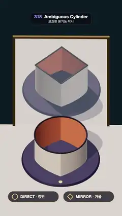

# 318 · Ambiguous Cylinder · 모호한 원기둥 착시



**EN** A tube on a turntable looks round from the front but square in the mirror behind it; a half turn swaps them, and a side view shows its wavy rim.  
**KO** 회전판 위의 관이 정면에서는 둥글지만 뒤의 거울 속에서는 네모로 보인다. 반 바퀴 돌면 둘이 바뀌고, 옆에서 보면 테두리가 물결친다.

[Video (mp4)](https://sueun-dev.github.io/motion-effects/videos/318-ambiguous-cylinder.mp4) · [Code](../effects/318-ambiguous-cylinder.js) · Classic optical illusions · 고전 착시

## Prompt (English)

```text
Create an "Ambiguous Cylinder" motion effect (after Kokichi Sugihara): a tube in front of a mirror looks round directly and square in the mirror; it turns 180° and they swap; then a side view shows its true, wavy rim.

Look
- The tube: half-width 1, a thin wall from the table up to a rim of mean height 1.25, cream outside #FFF1DC, coral inside #F08A5D, a dark lip #2B2238 (a 0.028 tube along the rim). It stands on a dark violet turntable (r 1.5) with a small gold dot.
- The rim, for each x = cos u across the tube: c = √(1 − x²) (circle) and q = 1 − |x| (square on its corner); the plan point is z = ±(c + q) / 2 and the height y = 1.25 ∓ (c − q) · tan 45° / 2 (front low, back high).
- A light table #D9CDBE, a teal wall #1F3B4A 1.9 behind the tube with a tall mirror (3.5 × 4.7) in a brass frame.
- An orthographic camera looking down at 45°. Light: a warm key #FFF1E0 from (−3, 7, 4) casting soft shadows, a cool back light from (2.5, 6, −6), a hemisphere fill.
- Pills at the bottom: DIRECT · 정면 and MIRROR · 거울, each with an icon that morphs between a circle and a square on its corner. During the side view a caption: SIDE VIEW: THE RIM IS WAVY / 옆에서 보면 테두리가 물결친다.

Motion (0–5 s)
- 0.1–1.1 s: held: round in front, square in the mirror.
- 1.1–2.1 s (ease in-out): the turntable turns 180°; the shapes swap. 2.1–2.8 s held.
- 2.8–3.7 s: the camera drops to a low view from the right (yaw 0.85 rad, pitch 0.16 rad, zoom 1.25×) while the turntable makes the second half turn (2.9–5.0 s); the wavy rim shows. 4.2–5.1 s back to the 45° view, across the loop point.

Technique
- three.js. With an orthographic camera the mirror shows exactly the opposite 45° view, so one rim curve serves both views: from the front its front and back points land on the picture of a circle, from behind on the picture of a square.
- The mirror is a mirrored copy of the room (scale z = −1 about the mirror plane), with its own mirrored lights, rendered first; then the real room, whose wall has a hole for the mirror, hides the copy everywhere else; a 10 % pale glass tint sits in the hole.
- Each frame averages 24 renders spread over its 1/30 s (motion blur for the turn and the camera move). PCF soft shadows, ACES Filmic tone mapping in an output pass.

Output and rules
- One self-contained HTML file with no external assets (three.js from a CDN is fine if you use it), drawing on a 1080 × 1920 canvas (9:16) scaled to fit the window.
- Write a function renderFrame(t) that draws the frame for time t in seconds, and preview it with requestAnimationFrame. Everything must be a pure function of t and fixed seeds: no Math.random(), Date or state carried between frames, so frame i = renderFrame(i / 30) can be exported to a 30 fps video.
- Loop seamlessly every 5 seconds: renderFrame(5) must look exactly like renderFrame(0).
- No flicker of any kind: no noise or grain that changes from frame to frame, no strobing or blinking, no z-fighting, no shimmering 1 px lines. Any grain or texture stays fixed to the screen or to the object.
- Keep the top 280 px free of important content (a title label goes there) and fill the whole frame with a designed background.
```

## 프롬프트 (한국어)

```text
"모호한 원기둥 착시" 모션 효과를 만들어 줘(스기하라 고키치 작품에서): 거울 앞의 관이 정면에서는 둥글고 거울 속에서는 네모로 보인다. 180° 돌면 둘이 바뀌고, 옆에서 보면 물결치는 진짜 테두리가 드러난다.

모양
- 관: 반폭 1, 탁자에서 평균 높이 1.25의 테두리까지 얇은 벽, 바깥 크림 #FFF1DC, 안쪽 산호 #F08A5D, 테두리를 따라 짙은 입술 #2B2238(굵기 0.028 관). 작은 금색 점이 있는 짙은 보라 회전판(r 1.5) 위에 선다.
- 테두리: 관을 가로지르는 x = cos u마다 c = √(1 − x²)(원), q = 1 − |x|(모서리로 선 네모). 평면 위치 z = ±(c + q) / 2, 높이 y = 1.25 ∓ (c − q) · tan 45° / 2(앞은 낮고 뒤는 높다).
- 밝은 탁자 #D9CDBE, 관 뒤 1.9에 청록 벽 #1F3B4A와 놋쇠 틀의 키 큰 거울(3.5 × 4.7).
- 45°로 내려다보는 직교 카메라. 조명: (−3, 7, 4)의 따뜻한 키 #FFF1E0(부드러운 그림자), (2.5, 6, −6)의 서늘한 뒤 조명, 반구광.
- 아래 알약: DIRECT · 정면 과 MIRROR · 거울, 아이콘이 원과 모서리로 선 네모 사이를 바뀐다. 옆 화면에서는 캡션 SIDE VIEW: THE RIM IS WAVY / 옆에서 보면 테두리가 물결친다.

움직임 (0–5초)
- 0.1–1.1초: 정지: 정면은 둥글고 거울은 네모.
- 1.1–2.1초(ease in-out): 회전판이 180° 돈다. 모양이 맞바뀐다. 2.1–2.8초 정지.
- 2.8–3.7초: 카메라가 오른쪽 낮은 시점으로 내려가고(요 0.85 rad, 피치 0.16 rad, 1.25배 줌), 그동안 회전판이 나머지 반 바퀴를 돈다(2.9–5.0초). 물결치는 테두리가 보인다. 4.2–5.1초 루프 지점을 지나며 45° 시점으로 돌아온다.

기법
- three.js. 직교 카메라면 거울이 정확히 반대쪽 45° 시점을 보여 주므로 테두리 곡선 하나로 두 시점을 맞춘다: 앞에서 보면 앞뒤 점이 원의 그림에, 뒤에서 보면 네모의 그림에 놓인다.
- 거울은 방을 거울면에 대해 뒤집은 복사본(z 배율 −1)과 그에 맞게 뒤집은 조명으로, 먼저 렌더한다. 그다음 거울 자리에 구멍이 난 벽이 있는 진짜 방을 그려 나머지를 가린다. 구멍에는 10 %의 옅은 유리 색을 얹는다.
- 프레임마다 1/30초에 걸친 24번의 렌더를 평균낸다(회전과 카메라 이동의 모션 블러). PCF 소프트 그림자, output pass의 ACES Filmic 톤 매핑.

출력과 규칙
- 외부 파일 없는 HTML 파일 하나(three.js를 쓴다면 CDN은 괜찮다). 1080 × 1920(9:16) 캔버스에 그리고 창 크기에 맞춰 보이게 한다.
- 시간 t(초)의 프레임을 그리는 renderFrame(t) 함수를 만들고, 미리보기는 requestAnimationFrame으로 돌린다. 모든 것은 t와 고정 시드만으로 정해진다: Math.random(), Date, 프레임 사이에 쌓이는 상태 금지. 그래야 i번째 프레임 = renderFrame(i / 30)으로 30fps 영상을 뽑을 수 있다.
- 5초마다 끊김 없이 반복: renderFrame(5)는 renderFrame(0)과 똑같아 보여야 한다.
- 어떤 깜빡임도 금지: 프레임마다 바뀌는 노이즈·그레인, 번쩍임·깜빡임, z-fighting, 반짝이며 떨리는 1px 선 모두 금지. 그레인·질감은 화면이나 물체에 고정한다.
- 위쪽 280px에는 중요한 내용을 두지 않고(제목 라벨 자리), 화면 전체를 디자인된 배경으로 채운다.
```
