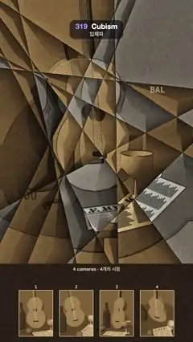

# 319 · Cubism · 입체파



**EN** A café still life (guitar, bottle, goblet, newspaper) seen by four cameras at once is cut into drifting ochre and grey facets; the four raw views sit below.  
**KO** 기타·병·잔·신문이 놓인 카페 정물을 네 대의 카메라가 한꺼번에 보고, 그 시점들이 천천히 움직이는 황토·회색 면으로 쪼개져 한 그림이 된다. 아래에 네 원본 시점이 있다.

[Video (mp4)](https://sueun-dev.github.io/motion-effects/videos/319-cubism.mp4) · [Code](../effects/319-cubism.js) · Art & craft · 예술·공예

## Prompt (English)

```text
Create a "Cubism" motion effect in the manner of analytic cubism: one still life rendered from four cameras at once and broken into overlapping planes, so it is seen from the front, the side and above in a single ochre-and-grey picture.

Look
- The still life (three.js), on a round café table (radius 1.15, top #6E5434) in front of a wall #9A8F7C, background #8A8070:
  - a guitar: an hourglass body extruded 0.16 deep (lower bout radius 0.42, upper bout radius 0.33 centred 0.58 higher, waist about 0.27), a round sound hole of radius 0.1, a dark neck 0.1 × 0.8, a head 0.14 × 0.22, a bridge and six thin strings; body colour #C9A46A; standing at (0.05, 0.42, −0.25), tilted (−0.2, −0.32, 0.08) rad;
  - a dark green bottle 1.14 high #3E4A36 at (−0.62, 0, −0.1), a pale goblet 0.46 high #E6E0D2 at (0.62, 0, 0.25);
  - a folded newspaper 0.8 × 0.56 lying on the table with the headline "LE JOURNAL" and grey columns, a round fruit #B0743A and a dark pipe bowl.
  - Light: a white directional light (2.6) from (−3, 5, 4) and a hemisphere light (1.1).
- Four cameras, field of view 30°, 5.1 units from the still life, all looking at (0, 0.62, 0): azimuth / elevation 0° / 12°, −40° / 26°, 36° / 4° and 12° / 60°. Each renders into its own 720 × 987 target (4× MSAA), framed for the painting area.
- The painting fills the top 1480 px. Eleven straight lines cut it into facets; line i passes through (180 + (397·i mod 720), 360 + (271·i mod 900)) px at angle [1.35, 0.42, 2.05, 1.62, 0.9, 2.6, 1.15, 0.15, 1.9, 2.35, 0.65][i] rad.
- Every facet (the set of line sides a pixel is on) picks one camera from a hash of its id: camera 1 for 40 % of facets, cameras 2, 3 and 4 for 20 % each. It shows that camera's picture shifted by up to ±25 px and scaled by up to ±5 % about (540, 760), so neighbouring facets do not line up.
- Tone: the view's brightness (gamma 1/2.2) is mapped to the palette #1A140F → #4D3821 → #8C6B40 → #BFA16B → #E8DBB8 (stops at 0, 0.3, 0.55, 0.78, 1). About 30 % of the facets are turned 70 % toward cool grey.
- Passage: along its nearest cutting line each facet darkens on one side (−0.32 · e^(−d/55 px)) and lightens on the other (+0.12 · e^(−d/30 px)), plus a facet-wide tone shift of ±0.06.
- Lines: object contours (the view's brightness gradient over 2 px) darken by up to 55 %; the cutting lines are 1–2.6 px dark strokes that come and go along their length (value noise at 140 px), darkening by 65 %.
- Brushwork: a fixed mosaic of short dabs 22 × 8 px, laid in one of four directions per 150 px patch, changing the tone by ±0.035.
- Stencilled letters "JOU" (64 px monospace, umber at 70 %) at (92, 1120) and "BAL" (46 px, cream at 55 %) at (840, 520).
- Below the painting, a dark umber strip (y 1480–1920) shows the four raw views as 186 × 255 px thumbnails at x = 108 + 226·k with cream 3 px frames, numbered 1–4, under the caption "4 cameras · 4개의 시점".

Motion (0–5 s), a = 2π · t / 5
- Camera k sways: azimuth + 7°·sin(a + 1.7k), elevation + 3°·sin(a + k), so every facet's view keeps turning a little.
- Cutting line i turns by 0.07·sin(a + 1.7i) rad and drifts by 18 px·sin(a + 2.21i) across and 14 px·cos(a + 1.7i) down, so the facets slide, open and close.
- Everything is built from sin and cos of a, so 5 s meets 0 s.

Technique
- Render the scene four times per frame into four render targets, then draw a full-screen quad whose fragment shader does the faceting: for each pixel, the signed distance to every line gives the facet id (one bit per line) and the nearest line; a hash of the id picks the camera, offset and tone.
- Only one camera texture is read per pixel (plus four taps for the contour gradient), so the shader stays cheap.
- The brushwork, the letters and the thumbnail strip are fixed to the frame; only the views and the lines move.

Output and rules
- One self-contained HTML file with no external assets (three.js from a CDN is fine if you use it), drawing on a 1080 × 1920 canvas (9:16) scaled to fit the window.
- Write a function renderFrame(t) that draws the frame for time t in seconds, and preview it with requestAnimationFrame. Everything must be a pure function of t and fixed seeds: no Math.random(), Date or state carried between frames, so frame i = renderFrame(i / 30) can be exported to a 30 fps video.
- Loop seamlessly every 5 seconds: renderFrame(5) must look exactly like renderFrame(0).
- No flicker of any kind: no noise or grain that changes from frame to frame, no strobing or blinking, no z-fighting, no shimmering 1 px lines. Any grain or texture stays fixed to the screen or to the object.
- Keep the top 280 px free of important content (a title label goes there) and fill the whole frame with a designed background.
```

## 프롬프트 (한국어)

```text
분석적 입체파 방식의 "입체파" 모션 효과를 만들어 줘: 정물 하나를 카메라 네 대로 한꺼번에 렌더해 겹치는 면으로 쪼개서, 앞·옆·위에서 본 모습이 황토·회색의 한 그림 안에 같이 보이게 한다.

모양
- 정물(three.js): 벽 #9A8F7C 앞 둥근 카페 탁자(반지름 1.15, 상판 #6E5434), 배경 #8A8070:
  - 기타: 깊이 0.16으로 돌출한 모래시계 몸통(아래 둥근 부분 반지름 0.42, 0.58 위의 위쪽 부분 반지름 0.33, 허리 약 0.27), 반지름 0.1의 둥근 울림구멍, 어두운 넥 0.1 × 0.8, 헤드 0.14 × 0.22, 브리지와 가는 줄 여섯; 몸통색 #C9A46A; (0.05, 0.42, −0.25)에 세우고 (−0.2, −0.32, 0.08) rad 기울인다;
  - 높이 1.14의 짙은 초록 병 #3E4A36(−0.62, 0, −0.1), 높이 0.46의 밝은 잔 #E6E0D2(0.62, 0, 0.25);
  - 탁자 위에 놓인 0.8 × 0.56 신문("LE JOURNAL" 제목과 회색 단), 둥근 과일 #B0743A, 어두운 파이프 대통.
  - 조명: (−3, 5, 4)에서 오는 흰 방향광(2.6)과 반구광(1.1).
- 카메라 넷: 시야각 30°, 정물에서 5.1 떨어져 모두 (0, 0.62, 0)을 본다. 방위각/고도는 0°/12°, −40°/26°, 36°/4°, 12°/60°. 각자 720 × 987 렌더 타깃(4× MSAA)에 그림 영역에 맞춰 그린다.
- 그림은 위쪽 1480px를 채운다. 직선 11개가 그림을 면으로 자른다: i번째 선은 (180 + (397·i mod 720), 360 + (271·i mod 900))px를 지나고 각도는 [1.35, 0.42, 2.05, 1.62, 0.9, 2.6, 1.15, 0.15, 1.9, 2.35, 0.65][i] rad.
- 면(픽셀이 각 선의 어느 쪽에 있는지의 조합)마다 id의 해시로 카메라 하나를 고른다: 40 %는 카메라 1, 카메라 2·3·4는 20 %씩. 그 카메라의 그림을 최대 ±25px 옮기고 (540, 760)을 중심으로 최대 ±5 % 키우거나 줄여서 보여 주므로 이웃 면끼리 어긋난다.
- 색조: 시점 그림의 밝기(감마 1/2.2)를 팔레트 #1A140F → #4D3821 → #8C6B40 → #BFA16B → #E8DBB8(0, 0.3, 0.55, 0.78, 1 위치)로 옮긴다. 면의 약 30 %는 차가운 회색 쪽으로 70 % 돌린다.
- 파사주: 각 면은 가장 가까운 자르는 선을 따라 한쪽은 어두워지고(−0.32 · e^(−d/55px)) 다른 쪽은 밝아진다(+0.12 · e^(−d/30px)). 면 전체에 ±0.06의 명도 차를 더한다.
- 선: 물체 윤곽(시점 그림 밝기의 2px 기울기)은 최대 55 % 어둡게; 자르는 선은 1–2.6px의 어두운 붓선으로, 길이를 따라 나타났다 사라진다(140px 값 노이즈), 65 % 어둡게.
- 붓자국: 22 × 8px 짧은 붓질이 150px 구역마다 네 방향 중 하나로 깔린 고정 모자이크, 명도 ±0.035.
- 스텐실 글자 "JOU"(64px 고정폭, 70 % 고동색)를 (92, 1120)에, "BAL"(46px, 55 % 크림색)을 (840, 520)에.
- 그림 아래 어두운 고동색 띠(y 1480–1920)에 네 원본 시점을 186 × 255px 썸네일로 x = 108 + 226·k에 놓고, 3px 크림색 테두리와 1–4 번호, 캡션 "4 cameras · 4개의 시점"을 단다.

움직임 (0–5초), a = 2π · t / 5
- k번째 카메라가 흔들린다: 방위각 + 7°·sin(a + 1.7k), 고도 + 3°·sin(a + k). 그래서 면마다 보이는 시점이 조금씩 계속 돈다.
- i번째 자르는 선은 0.07·sin(a + 1.7i) rad 돌고, 가로로 18px·sin(a + 2.21i), 세로로 14px·cos(a + 1.7i) 흘러서 면이 미끄러지고 열리고 닫힌다.
- 모두 a의 sin·cos로 만들어 5초가 0초와 이어진다.

기법
- 매 프레임 장면을 렌더 타깃 넷에 네 번 그린 뒤, 화면 전체 사각형의 프래그먼트 셰이더에서 면을 나눈다: 픽셀에서 각 선까지의 부호 있는 거리로 면 id(선마다 1비트)와 가장 가까운 선을 구하고, id의 해시로 카메라·이동량·명도를 고른다.
- 픽셀마다 카메라 텍스처 하나만 읽고(윤곽 기울기용 4탭 추가) 가볍게 유지한다.
- 붓자국, 글자, 썸네일 띠는 화면에 고정되고, 시점 그림과 선만 움직인다.

출력과 규칙
- 외부 파일 없는 HTML 파일 하나(three.js를 쓴다면 CDN은 괜찮다). 1080 × 1920(9:16) 캔버스에 그리고 창 크기에 맞춰 보이게 한다.
- 시간 t(초)의 프레임을 그리는 renderFrame(t) 함수를 만들고, 미리보기는 requestAnimationFrame으로 돌린다. 모든 것은 t와 고정 시드만으로 정해진다: Math.random(), Date, 프레임 사이에 쌓이는 상태 금지. 그래야 i번째 프레임 = renderFrame(i / 30)으로 30fps 영상을 뽑을 수 있다.
- 5초마다 끊김 없이 반복: renderFrame(5)는 renderFrame(0)과 똑같아 보여야 한다.
- 어떤 깜빡임도 금지: 프레임마다 바뀌는 노이즈·그레인, 번쩍임·깜빡임, z-fighting, 반짝이며 떨리는 1px 선 모두 금지. 그레인·질감은 화면이나 물체에 고정한다.
- 위쪽 280px에는 중요한 내용을 두지 않고(제목 라벨 자리), 화면 전체를 디자인된 배경으로 채운다.
```
