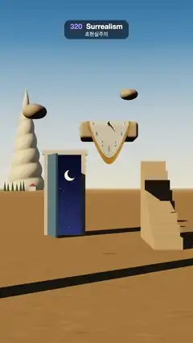

# 320 · Surrealism · 초현실주의



**EN** A seashell as tall as a mountain, floating stones, a lone door open onto night, stairs to nowhere and one soft watch dripping gold, on a warm dream plain.  
**KO** 산만 한 소라 껍데기, 떠 있는 돌, 홀로 서서 밤하늘로 열린 문, 어디로도 가지 않는 계단, 금빛 방울을 떨구며 녹아내리는 시계 하나가 따뜻한 꿈의 평원에 있다.

[Video (mp4)](https://sueun-dev.github.io/motion-effects/videos/320-surrealism.mp4) · [Code](../effects/320-surrealism.js) · Art & craft · 예술·공예

## Prompt (English)

```text
Create a "Surrealism" motion effect: an original dream plain that combines several surrealist devices — impossible scale, floating stones, a door to another sky, a staircase to nowhere and one soft melting watch — under a warm, clean evening light.

Look
- three.js, ACES tone mapping (exposure 1.05), a 38° camera.
- Sky: a dome shaded by elevation (sine of height): #F4E7B8 at the horizon, #EBE3C4 at 0.04, #A9C6D6 at 0.12, #4F82B0 at 0.26, #1E4A7E from 0.45 up. Fog #F1E3B4 from 40 to 300 units. The plain: a 600 × 600 ground #C49A64 with a fixed speckled sand texture repeated 60 times.
- Impossible scale: a spiral seashell 26.6 high standing on the horizon at (−16.5, 0, −120): a lathe cone with radius (1 − y/3.6)^0.9, seven whorls winding up it (phase = angle/2π + 7y/3.6, radius × (0.86 + 0.14·sin(π·phase))), cream #F3E7D2 with brown bands #B98A5C in the grooves, scaled (5.2, 7.4, 5.2). At its foot, six cypresses #3E5A3A 1.6–2.4 high and a small white cottage #F2EADB with a red roof #B5543C, no bigger than one whorl.
- A door frame standing alone at (−0.6, 0, −2.6): cream posts and lintel #EFE4D0 round an opening 0.8 × 1.95, a blue door #5E86A8 swung open 1.25 rad toward us. The opening shows a night sky drawn in screen space (so it reads as a window to somewhere else): a gradient (0.17, 0.22, 0.45) → (0.03, 0.05, 0.16) upward, fixed soft stars (one in 7 of the 22 px cells), and a crescent moon of radius 30 px placed where the point (−0.48, 1.45, −2.6) falls on screen.
- A staircase that goes nowhere: eight solid steps 0.55 wide (rise 0.22, run 0.3, #DDBE92) at x = 1.48 climbing away from us to 1.76 and stopping in the air.
- Floating stones: a flat rounded slab 1.05 × 0.3 × 0.8 (corner radius 0.06, #C9B49A) with its top at (0.35, 2.35, 0.3), and two smooth pebbles (radius 0.32 at (−1.45, 3.1, −3.5) and 0.26 at (1.15, 3.9, −5.0), squashed to 0.62 high).
- A column 6 high out of the picture at (−3.6, 3, 6.2): only its long shadow crosses the foreground.
- Light: a low warm sun #FFE0B0 (3.2) from (−7, 5, 4.5) aimed at (0, 0, −1.5), 4096 px soft shadows (the slab's shadow falls across the stairs); a hemisphere light #8FB0D8 / #7A5A3A (0.45).
- The one soft watch (radius 0.4, a disc of 30 rings × 120 spokes): a 512 px dial #EEF1F2 with a gold bezel #C79A3A, serif numbers 1–12, minute dots, an hour hand and a minute hand; polished gold behind. It lies on the slab (s = 0.1 − v across the edge): flat on the top, round the rounded corner (radius 0.072), then down the front and hanging free below the stone. The hanging part melts: length d = d₀·(1 + melt) + 1.6·d₀² + 0.22·d₀·(1 − (u/0.4)²), width × (1 − 0.3·d₀/0.4), leaning out by 0.05·d² with soft ripples 0.035·d·sin(11u + 0.6).

Motion (0–5 s), a = 2π · t / 5
- The camera drifts slowly: position (0.25·sin a, 1.2 + 0.04·sin a, 9.8 − 0.2·cos a), looking at (0.15, 1.5, −1).
- The three stones bob 0.05·sin(a + phase) (phases 0, 1.7, 3.4); the watch rides on the slab.
- The watch keeps softening and settling: melt = 0.06·(1 − cos a). Its minute hand turns once per loop (t / 5 of a turn); the hour hand stands still at 0.37 of a turn.
- A gold drop gathers at the lowest point of the hem: it grows from nothing over 0–3.2 s (to radius 0.03), stretches to 1.8× its height over 2.4–3.2 s, lets go at 3.2 s, falls the whole way to the sand with gravity (about 0.6 s) and shrinks into a small gold puddle (radius 0.08, #B98430). Nothing hangs from about 3.8 s to 5 s; the next drop starts at 0.
- Everything else stays still; the stars in the doorway never twinkle.

Technique
- Bend the watch's flat (u, v) coordinates into place every frame (in the slab's own frame) and recompute the normals; one geometry carries the dial (front) and the gold (back side).
- The doorway's sky is a small shader on a plane that reads gl_FragCoord, so its stars and moon stay fixed on screen while the frame drifts past them.
- Only the gold gets an environment map; the rest is lit by the sun and the sky light, so the shadows stay long and clean. All motion is sin / cos of a or a one-off that ends where it began, so frame 150 meets frame 0.

Output and rules
- One self-contained HTML file with no external assets (three.js from a CDN is fine if you use it), drawing on a 1080 × 1920 canvas (9:16) scaled to fit the window.
- Write a function renderFrame(t) that draws the frame for time t in seconds, and preview it with requestAnimationFrame. Everything must be a pure function of t and fixed seeds: no Math.random(), Date or state carried between frames, so frame i = renderFrame(i / 30) can be exported to a 30 fps video.
- Loop seamlessly every 5 seconds: renderFrame(5) must look exactly like renderFrame(0).
- No flicker of any kind: no noise or grain that changes from frame to frame, no strobing or blinking, no z-fighting, no shimmering 1 px lines. Any grain or texture stays fixed to the screen or to the object.
- Keep the top 280 px free of important content (a title label goes there) and fill the whole frame with a designed background.
```

## 프롬프트 (한국어)

```text
"초현실주의" 모션 효과를 만들어 줘: 여러 초현실주의 장치 — 불가능한 크기, 떠 있는 돌, 다른 하늘로 열린 문, 어디로도 가지 않는 계단, 녹아내리는 시계 하나 — 를 새롭게 엮은 꿈의 평원을, 따뜻하고 맑은 저녁빛 아래에 직접 지은 장면으로 만든다.

모양
- three.js, ACES 톤 매핑(노출 1.05), 시야각 38° 카메라.
- 하늘: 고도(높이의 사인)에 따라 칠한 돔. 지평선 #F4E7B8, 0.04에서 #EBE3C4, 0.12에서 #A9C6D6, 0.26에서 #4F82B0, 0.45부터 #1E4A7E. 안개 #F1E3B4(40–300). 평원: 600 × 600 땅 #C49A64에 고정된 모래 반점 텍스처를 60번 반복.
- 불가능한 크기: 지평선 (−16.5, 0, −120)에 높이 26.6의 소라 껍데기가 서 있다. 반지름 (1 − y/3.6)^0.9의 선반 회전체 원뿔에 일곱 겹의 나선이 감겨 오르고(위상 = 각도/2π + 7y/3.6, 반지름 × (0.86 + 0.14·sin(π·위상))), 크림색 #F3E7D2에 홈마다 갈색 띠 #B98A5C, (5.2, 7.4, 5.2)로 키운다. 발치에는 높이 1.6–2.4의 사이프러스 여섯 그루 #3E5A3A와, 나선 한 겹보다 작은 흰 오두막 #F2EADB(빨간 지붕 #B5543C).
- 홀로 선 문틀 (−0.6, 0, −2.6): 크림색 기둥과 상인방 #EFE4D0이 0.8 × 1.95 문간을 두르고, 파란 문짝 #5E86A8이 우리 쪽으로 1.25 rad 열려 있다. 문간에는 화면 좌표로 그린 밤하늘(다른 곳으로 난 창처럼 보이게): 위로 갈수록 (0.17, 0.22, 0.45) → (0.03, 0.05, 0.16) 그라디언트, 고정된 부드러운 별(22px 칸 일곱 개 중 하나꼴), 점 (−0.48, 1.45, −2.6)이 화면에 맺히는 자리에 반지름 30px 초승달.
- 어디로도 가지 않는 계단: x = 1.48에 폭 0.55의 꽉 찬 계단 여덟 단(단 높이 0.22, 너비 0.3, #DDBE92)이 우리에게서 멀어지며 1.76까지 올라가 허공에서 멈춘다.
- 떠 있는 돌: 윗면이 (0.35, 2.35, 0.3)에 있는 1.05 × 0.3 × 0.8의 납작하고 둥근 판돌(모서리 반지름 0.06, #C9B49A), 매끈한 자갈 둘(반지름 0.32 (−1.45, 3.1, −3.5), 0.26 (1.15, 3.9, −5.0), 높이 0.62로 납작).
- 화면 밖 (−3.6, 3, 6.2)에 높이 6의 기둥: 긴 그림자만 앞쪽을 가로지른다.
- 조명: (−7, 5, 4.5)에서 (0, 0, −1.5)를 향하는 낮고 따뜻한 해 #FFE0B0(3.2), 4096px 부드러운 그림자(판돌 그림자가 계단에 걸린다); 반구광 #8FB0D8 / #7A5A3A(0.45).
- 하나뿐인 무른 시계(반지름 0.4, 링 30 × 살 120의 원판): 512px 문자판 #EEF1F2, 금 테두리 #C79A3A, 세리프 숫자 1–12, 분 점, 시침과 분침; 뒷면은 광택 금. 판돌 위에 놓인다(모서리를 가로지르는 좌표 s = 0.1 − v): 윗면에 평평하게, 둥근 모서리(반지름 0.072)를 돌아, 앞면을 따라 내려가 돌 아래로 늘어진다. 늘어진 부분은 녹는다: 길이 d = d₀·(1 + melt) + 1.6·d₀² + 0.22·d₀·(1 − (u/0.4)²), 폭 × (1 − 0.3·d₀/0.4), 0.05·d²만큼 바깥으로 기울고 0.035·d·sin(11u + 0.6)으로 부드럽게 물결친다.

움직임 (0–5초), a = 2π · t / 5
- 카메라가 천천히 흘러간다: 위치 (0.25·sin a, 1.2 + 0.04·sin a, 9.8 − 0.2·cos a), (0.15, 1.5, −1)을 본다.
- 돌 셋이 0.05·sin(a + 위상)(위상 0, 1.7, 3.4)으로 둥실거리고, 시계는 판돌에 실려 함께 움직인다.
- 시계는 계속 무르고 가라앉는다: melt = 0.06·(1 − cos a). 분침은 한 루프에 한 바퀴(t / 5바퀴), 시침은 0.37바퀴에 멈춰 있다.
- 가장자리의 가장 낮은 점에 금빛 방울이 맺힌다: 0–3.2초에 크기 0에서 반지름 0.03까지 자라고, 2.4–3.2초에 높이가 1.8배로 늘어지며, 3.2초에 떨어져 모래까지 중력대로(약 0.6초) 떨어지고, 작은 금 웅덩이(반지름 0.08, #B98430)로 줄어들어 사라진다. 약 3.8초부터 5초까지는 아무것도 매달려 있지 않고, 0초에 다음 방울이 시작된다.
- 나머지는 모두 가만히 있고, 문간의 별은 절대 반짝이지 않는다.

기법
- 시계의 평평한 (u, v) 좌표를 매 프레임 (판돌 자신의 좌표계에서) 휘어 놓고 법선을 다시 계산한다. 지오메트리 하나에 문자판(앞면)과 금(뒷면)을 씌운다.
- 문간의 하늘은 gl_FragCoord를 읽는 작은 셰이더를 씌운 평면이라, 문틀이 흘러가도 별과 달은 화면에 고정된다.
- 환경맵은 금에만 주고 나머지는 해와 하늘빛으로만 비추어 그림자가 길고 깔끔하다. 모든 움직임은 a의 sin·cos이거나 시작한 곳으로 돌아오는 한 번의 동작이라 150번째 프레임이 0번째와 이어진다.

출력과 규칙
- 외부 파일 없는 HTML 파일 하나(three.js를 쓴다면 CDN은 괜찮다). 1080 × 1920(9:16) 캔버스에 그리고 창 크기에 맞춰 보이게 한다.
- 시간 t(초)의 프레임을 그리는 renderFrame(t) 함수를 만들고, 미리보기는 requestAnimationFrame으로 돌린다. 모든 것은 t와 고정 시드만으로 정해진다: Math.random(), Date, 프레임 사이에 쌓이는 상태 금지. 그래야 i번째 프레임 = renderFrame(i / 30)으로 30fps 영상을 뽑을 수 있다.
- 5초마다 끊김 없이 반복: renderFrame(5)는 renderFrame(0)과 똑같아 보여야 한다.
- 어떤 깜빡임도 금지: 프레임마다 바뀌는 노이즈·그레인, 번쩍임·깜빡임, z-fighting, 반짝이며 떨리는 1px 선 모두 금지. 그레인·질감은 화면이나 물체에 고정한다.
- 위쪽 280px에는 중요한 내용을 두지 않고(제목 라벨 자리), 화면 전체를 디자인된 배경으로 채운다.
```
