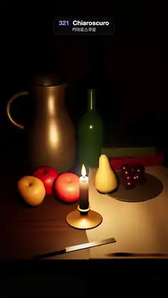

# 321 · Chiaroscuro · 키아로스쿠로



**EN** One candle glides across a still life of a pewter jug, a bottle, fruit and books; each form steps out of deep black as the steady flame passes, then sinks back.  
**KO** 촛불 하나가 백랍 주전자·병·과일·책이 놓인 정물 앞을 미끄러져 지나가면, 흔들림 없는 불꽃이 다가가는 형태마다 깊은 어둠에서 떠올랐다가 다시 가라앉는다.

[Video (mp4)](https://sueun-dev.github.io/motion-effects/videos/321-chiaroscuro.mp4) · [Code](../effects/321-chiaroscuro.js) · Art & craft · 예술·공예

## Prompt (English)

```text
Create a "Chiaroscuro" motion effect in the tenebrist manner: a still life lit by one candle and nothing else, so forms emerge from deep black only where the flame is near. The flame burns perfectly steadily; it never flickers.

Look
- three.js, ACES tone mapping (exposure 1.1), background #050403, a 28° camera at (0, 4.6, 7.6) looking at (0, 0.95, 0.15).
- The room: a dark plaster wall #3E3328 at z = −2.6; a heavy table 7 × 0.24 × 3.4 (top at y = 0, front edge at z = 1.4) with a fixed dark wood texture (#3A2516 with soft grain).
- A greyish linen cloth #B4AC9C (1.8 × 3.4, 90 × 170 segments) lies over the right half of the table (x 0.05 to 1.85) with faint folds, its left edge gently wavy, and hangs over the front edge.
- The still life:
  - a pewter jug 1.52 high (lathe, #9A968C, metalness 0.75, roughness 0.38) with a ring handle, at (−0.55, 0, −1.15);
  - a green wine bottle 1.36 high (#2F5A35, clearcoat) at (0.12, 0, −1.25);
  - three apples (#9C1E14, #C2391C, #B58A26) at (−0.56, −0.3), (−0.25, −0.1), (−0.8, −0.02); a yellow pear #A89A3A at (0.36, −0.25); a pewter plate with 22 dark grapes #3A1A3E at (0.72, −0.32);
  - two old books with their spines toward us (0.74 × 0.2 × 1.0, spine #8A3A22; 0.62 × 0.16 × 0.86, spine #4A5E34; cream page edges), stacked at (0.72, −1.35);
  - a knife over the front edge at (−0.25, 1.3), turned 0.35 rad.
- The candle: a brass chamberstick (dish radius 0.26, metalness 0.85), a cream candle 0.46 high and 0.06 wide whose wax glows from inside near the top (an emissive gradient #FFC27A at the top → #7A3A12 at 35 % → black), a black wick, a teardrop flame 0.2 high (white-yellow core, orange tip, a blue root, additive) and a soft warm halo sprite 1.8 wide.
- The only light: a point light #FFB061, intensity 5.5, physical inverse-square falloff (decay 2), at the flame, casting 2048 px shadows (bias −0.002, normal bias 0.02). No fill, no ambient: what the flame does not reach stays black.
- Varnish: a fixed vignette (clear in the middle, 55 % black at the edges) and a fixed scatter of 9000 faint 1–3 px specks laid over every frame.

Motion (0–5 s), a = 2π · t / 5
- The candle glides across the front of the table and back: x = 0.7·sin a, z = 0.6 − 0.1·cos 2a (a little nearer at the ends).
- The flame leans gently against the motion: rotation 0.06 × velocity (velocity from the path 0.05 s ahead). Its size and brightness never change, so the light never flickers.
- As the flame passes, the apples, the pear, the jug and the cloth light up one after another, highlights slide over the pewter and the bottle, and the shadows swing round.

Technique
- MeshStandard / MeshPhysical materials; the flame is a lathe teardrop with a small shader (colour by height, brighter where it faces the camera) and additive blending; the candle body and wick cast no shadow, so the table round the candle stays lit.
- The point light rides inside the flame's pivot, so the light, the flame and its halo move together.
- The vignette and specks are one canvas made once and drawn on top of every frame.

Output and rules
- One self-contained HTML file with no external assets (three.js from a CDN is fine if you use it), drawing on a 1080 × 1920 canvas (9:16) scaled to fit the window.
- Write a function renderFrame(t) that draws the frame for time t in seconds, and preview it with requestAnimationFrame. Everything must be a pure function of t and fixed seeds: no Math.random(), Date or state carried between frames, so frame i = renderFrame(i / 30) can be exported to a 30 fps video.
- Loop seamlessly every 5 seconds: renderFrame(5) must look exactly like renderFrame(0).
- No flicker of any kind: no noise or grain that changes from frame to frame, no strobing or blinking, no z-fighting, no shimmering 1 px lines. Any grain or texture stays fixed to the screen or to the object.
- Keep the top 280 px free of important content (a title label goes there) and fill the whole frame with a designed background.
```

## 프롬프트 (한국어)

```text
테네브리즘 방식의 "키아로스쿠로" 모션 효과를 만들어 줘: 촛불 하나만으로 비춘 정물이라, 불꽃이 가까이 있는 곳에서만 형태가 깊은 어둠 속에서 떠오른다. 불꽃은 완전히 고르게 타고, 절대 깜빡이지 않는다.

모양
- three.js, ACES 톤 매핑(노출 1.1), 배경 #050403, 시야각 28° 카메라를 (0, 4.6, 7.6)에 두고 (0, 0.95, 0.15)를 본다.
- 방: z = −2.6의 어두운 회벽 #3E3328; 7 × 0.24 × 3.4 묵직한 탁자(윗면 y = 0, 앞 모서리 z = 1.4)에 고정된 어두운 나무 텍스처(#3A2516에 부드러운 결).
- 회색빛 리넨 천 #B4AC9C(1.8 × 3.4, 90 × 170 분할)가 탁자 오른쪽 절반(x 0.05 ~ 1.85)을 덮고, 주름은 옅게, 왼쪽 가장자리는 살짝 물결치며, 앞 모서리 너머로 늘어진다.
- 정물:
  - 높이 1.52의 백랍 주전자(선반 회전체, #9A968C, 금속성 0.75, 거칠기 0.38)와 고리 손잡이, (−0.55, 0, −1.15);
  - 높이 1.36의 초록 와인병(#2F5A35, 클리어코트), (0.12, 0, −1.25);
  - 사과 셋(#9C1E14, #C2391C, #B58A26): (−0.56, −0.3), (−0.25, −0.1), (−0.8, −0.02); 노란 배 #A89A3A: (0.36, −0.25); 어두운 포도알 22개 #3A1A3E를 담은 백랍 접시: (0.72, −0.32);
  - 책등이 앞을 보는 낡은 책 두 권(0.74 × 0.2 × 1.0, 책등 #8A3A22; 0.62 × 0.16 × 0.86, 책등 #4A5E34; 크림색 책배)을 (0.72, −1.35)에 쌓는다;
  - 앞 모서리 너머로 걸친 칼 하나, (−0.25, 1.3), 0.35 rad 돌림.
- 초: 황동 촛대(받침 반지름 0.26, 금속성 0.85), 높이 0.46·폭 0.06의 크림색 초는 윗부분이 안에서 빛난다(발광 그라디언트: 위 #FFC27A → 35 %에서 #7A3A12 → 검정). 검은 심지, 높이 0.2의 물방울 모양 불꽃(흰빛·노란 속, 주황 끝, 파란 뿌리, 가산 혼합), 폭 1.8의 따뜻하고 부드러운 후광 스프라이트.
- 유일한 빛: 불꽃 위치의 점광원 #FFB061, 세기 5.5, 물리적 역제곱 감쇠(decay 2), 2048px 그림자(bias −0.002, normal bias 0.02). 보조광·환경광 없음: 불꽃이 닿지 않는 곳은 검게 남는다.
- 바니시: 고정된 비네트(가운데는 맑고 가장자리는 55 % 검정)와 1–3px의 희미한 점 9000개를 고정해 매 프레임 위에 얹는다.

움직임 (0–5초), a = 2π · t / 5
- 초가 탁자 앞쪽을 가로질러 갔다가 돌아온다: x = 0.7·sin a, z = 0.6 − 0.1·cos 2a(양 끝에서 조금 더 가까이).
- 불꽃은 움직임 반대쪽으로 살짝 기운다: 회전 = 0.06 × 속도(속도는 0.05초 앞 경로에서 구함). 크기와 밝기는 바뀌지 않아 빛이 절대 깜빡이지 않는다.
- 불꽃이 지나가면 사과·배·주전자·천이 차례로 밝아지고, 하이라이트가 백랍과 병 위를 미끄러지며, 그림자가 돌아간다.

기법
- MeshStandard / MeshPhysical 재질. 불꽃은 선반 회전체 물방울에 작은 셰이더(높이에 따른 색, 카메라를 향한 곳이 더 밝게)와 가산 혼합. 초 몸통과 심지는 그림자를 드리우지 않아 초 둘레의 탁자가 밝게 남는다.
- 점광원을 불꽃의 회전축 안에 두어 빛·불꽃·후광이 함께 움직인다.
- 비네트와 점은 한 번 만든 캔버스 하나로, 매 프레임 위에 그린다.

출력과 규칙
- 외부 파일 없는 HTML 파일 하나(three.js를 쓴다면 CDN은 괜찮다). 1080 × 1920(9:16) 캔버스에 그리고 창 크기에 맞춰 보이게 한다.
- 시간 t(초)의 프레임을 그리는 renderFrame(t) 함수를 만들고, 미리보기는 requestAnimationFrame으로 돌린다. 모든 것은 t와 고정 시드만으로 정해진다: Math.random(), Date, 프레임 사이에 쌓이는 상태 금지. 그래야 i번째 프레임 = renderFrame(i / 30)으로 30fps 영상을 뽑을 수 있다.
- 5초마다 끊김 없이 반복: renderFrame(5)는 renderFrame(0)과 똑같아 보여야 한다.
- 어떤 깜빡임도 금지: 프레임마다 바뀌는 노이즈·그레인, 번쩍임·깜빡임, z-fighting, 반짝이며 떨리는 1px 선 모두 금지. 그레인·질감은 화면이나 물체에 고정한다.
- 위쪽 280px에는 중요한 내용을 두지 않고(제목 라벨 자리), 화면 전체를 디자인된 배경으로 채운다.
```
