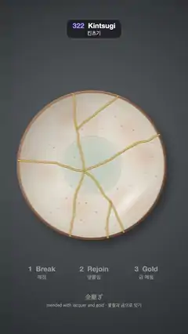

# 322 · Kintsugi · 킨츠기



**EN** A shino tea bowl seen from above cracks from one point; its seven pieces part and close, gold flows along each seam, a light glints, the next bowl slides in.  
**KO** 위에서 본 시노 찻사발이 한 점에서 금 가고, 일곱 조각이 벌어졌다 다시 붙은 뒤 모든 이음매를 따라 금이 흘러 빛나고, 다음 사발이 미끄러져 들어온다.

[Video (mp4)](https://sueun-dev.github.io/motion-effects/videos/322-kintsugi.mp4) · [Code](../effects/322-kintsugi.js) · Art & craft · 예술·공예

## Prompt (English)

```text
Create a "Kintsugi" motion effect: a ceramic tea bowl breaks and is mended the Japanese way, its pieces rejoined with lacquer and the seams filled with gold, so the repair shines instead of hiding.

Look
- Canvas 2D, seen straight from above. Background: dark slate linen, a radial gradient #5B5F63 (centre at (486, 800)) → #3F4347 → #25282C with 1800 fixed slubs (10–60 px strokes, white at 1.5–3.5 % or black at 3–6.5 %).
- The bowl, radius 430 px, centred at (540, 950), made once as an image:
  - a warm white shino glaze: radial gradient #D9DDD2 → #E6E2D6 (40 %) → #EFE8DA (85 %) → #E8DCC8;
  - 14 soft apricot blushes (rgba(222, 150, 105, 0.12–0.26), radius 50–140 px, 220–380 px from the centre) and 220 iron spots and pinholes (0.8–4 px);
  - the well: a slightly greener pool (rgba(170, 186, 172, 0.45)) of radius 175 px with a soft ring at 168 px;
  - light from the upper left: a diagonal wash from rgba(70, 60, 50, 0.32) at the upper left to +12 % white at the lower right, the steep wall near the rim darkened by 16 %, and a soft window reflection (an ellipse squashed to 0.3, radius 170 px) 290 px toward the lower right;
  - a 12 px brown rim (#B68458 → #8E5E3A → #5E3C26 along the diagonal) with a dark inner edge and a pale highlight on its upper left.
  - A soft shadow under it: the disc blurred by 26 px, offset (26, 32), black at 45 %.
- The break: a point at (−46, 34) from the centre. Five jagged cracks leave it at −2.75, −1.5, −0.3, 0.9 and 2.0 rad (±0.1), in steps of 16–30 px whose heading wanders by up to ±0.32 rad, until they pass the rim. Two branches split off (45 % along the second crack toward −0.95 rad, 50 % along the fourth toward 1.5 rad), making seven pieces. Each piece is the bowl image clipped by its polygon (its cracks closed by an arc beyond the rim).
- Three step labels in fixed places at y = 1560, x = 240, 540 and 840: "1 Break / 깨짐", "2 Rejoin / 맞붙임", "3 Gold / 금 메움" (40 px and 30 px). The current one turns gold #E8BA5C and a 140 px underline grows under it; the others stay grey #969696. Below: "金継ぎ" (34 px, Mincho) at y = 1720 and "mended with lacquer and gold · 옻칠과 금으로 잇기" at y = 1764.

Motion (0–5 s): local time u = (t + 0.09) mod 5
- u 0–1.3: the mended bowl slides out to the left while a whole new bowl slides in from the right, 1040 px apart, with a sine ease; each of these frames averages 8 instants across its 1/30 s.
- u 1.3–1.55: the new bowl rests.
- u 1.55–2.1: the cracks run out from the break point (up to 640 px of crack length; a branch starts when its crack reaches it), drawn as a 2.6 px dark line #3A2E26 with a 1.6 px white lip offset up and left.
- u 2.1–2.6: the seven pieces part, each 46 px outward from the break point, turning up to ±0.06 rad and growing 2.5 % as if lifted; the hairlines fade as they part. u 2.65–3.2: they close up again exactly.
- From u 3.25: gold flows along every seam from the break point outward at 560 px/s (branches start when the gold reaches them): a 10 px edge #7A5418, a 6.5 px body #D2A443 and a 2 px highlight #FFE7A6 offset up and left, with a bright bead and a 22 px glow at each flowing tip.
- u 4.1–4.75: a band of light at −45° sweeps across: a faint sheen on the glaze, and inside a 140 px band the gold turns #FFF3C8 with a 16 px glow. u 4.75–5: the mended bowl rests, then slides away.
- Step labels: Break for u 1.5–2.65, Rejoin 2.65–3.25, Gold 3.25–4.7, each fading in and out in place over 0.25 s.

Technique
- Make the bowl, its shadow, the seven piece images and the linen once in setup; per frame only translate, rotate and draw them, and stroke the cracks and the gold as partial polylines (the first s px of each crack).
- Before the cracks have run, draw the whole bowl image rather than the pieces, so no seam shows on the unbroken bowl.
- The loop point falls early in the slide, where the motion is gentle, so frame 150 meets frame 0.

Output and rules
- One self-contained HTML file with no external assets (three.js from a CDN is fine if you use it), drawing on a 1080 × 1920 canvas (9:16) scaled to fit the window.
- Write a function renderFrame(t) that draws the frame for time t in seconds, and preview it with requestAnimationFrame. Everything must be a pure function of t and fixed seeds: no Math.random(), Date or state carried between frames, so frame i = renderFrame(i / 30) can be exported to a 30 fps video.
- Loop seamlessly every 5 seconds: renderFrame(5) must look exactly like renderFrame(0).
- No flicker of any kind: no noise or grain that changes from frame to frame, no strobing or blinking, no z-fighting, no shimmering 1 px lines. Any grain or texture stays fixed to the screen or to the object.
- Keep the top 280 px free of important content (a title label goes there) and fill the whole frame with a designed background.
```

## 프롬프트 (한국어)

```text
"킨츠기" 모션 효과를 만들어 줘: 도자기 찻사발이 깨졌다가 일본식으로 고쳐진다. 조각을 옻칠로 다시 붙이고 이음매를 금으로 메워서, 수리 자국을 숨기지 않고 빛나게 한다.

모양
- 캔버스 2D, 바로 위에서 본다. 배경: 어두운 슬레이트색 리넨, 방사형 그라디언트 #5B5F63(중심 (486, 800)) → #3F4347 → #25282C에 고정된 실마디 1800개(10–60px 선, 흰색 1.5–3.5 % 또는 검정 3–6.5 %).
- 사발: 반지름 430px, 중심 (540, 950), 한 번 그려 이미지로 둔다:
  - 따뜻한 흰 시노 유약: 방사형 그라디언트 #D9DDD2 → #E6E2D6(40 %) → #EFE8DA(85 %) → #E8DCC8;
  - 은은한 살구빛 불 자국 14개(rgba(222, 150, 105, 0.12–0.26), 반지름 50–140px, 중심에서 220–380px)와 철점·바늘구멍 220개(0.8–4px);
  - 바닥 고임: 조금 더 초록빛 웅덩이(rgba(170, 186, 172, 0.45)) 반지름 175px, 168px에 부드러운 고리;
  - 왼쪽 위에서 오는 빛: 왼쪽 위 rgba(70, 60, 50, 0.32)에서 오른쪽 아래 흰색 +12 %로 가는 대각 그라디언트, 전 근처 가파른 벽은 16 % 어둡게, 오른쪽 아래로 290px 떨어진 곳에 창 반사(0.3로 납작한 타원, 반지름 170px);
  - 12px 갈색 전(대각선을 따라 #B68458 → #8E5E3A → #5E3C26), 어두운 안쪽 테두리와 왼쪽 위의 옅은 하이라이트.
  - 아래 그림자: 원판을 26px 흐리게, (26, 32) 옮겨, 45 % 검정.
- 깨짐: 중심에서 (−46, 34)인 한 점. 들쭉날쭉한 금 다섯이 −2.75, −1.5, −0.3, 0.9, 2.0 rad(±0.1)로 출발해 16–30px씩 나아가며 방향이 최대 ±0.32 rad 흔들리다가 전 밖으로 빠진다. 가지 금 둘(둘째 금의 45 % 지점에서 −0.95 rad 쪽, 넷째 금의 50 % 지점에서 1.5 rad 쪽)이 갈라져 조각이 일곱이 된다. 조각마다 사발 이미지를 그 다각형(금 선들과 전 바깥의 호로 닫힌)으로 잘라 쓴다.
- 고정 위치 단계 라벨 셋, y = 1560, x = 240, 540, 840: "1 Break / 깨짐", "2 Rejoin / 맞붙임", "3 Gold / 금 메움"(40px, 30px). 현재 단계는 금색 #E8BA5C가 되고 밑에 140px 밑줄이 자라며, 나머지는 회색 #969696. 아래에 "金継ぎ"(34px, 명조)를 y = 1720에, "mended with lacquer and gold · 옻칠과 금으로 잇기"를 y = 1764에.

움직임 (0–5초): 로컬 시간 u = (t + 0.09) mod 5
- u 0–1.3: 고친 사발이 왼쪽으로 빠지고 새 온전한 사발이 1040px 간격으로 오른쪽에서 사인 이징으로 들어온다. 이 프레임들은 1/30초 동안의 8순간을 평균한다.
- u 1.3–1.55: 새 사발이 멈춰 있다.
- u 1.55–2.1: 깨진 점에서 금이 뻗어 나간다(금 길이 최대 640px, 가지는 본 금이 그 지점에 닿을 때 시작). 2.6px 어두운 선 #3A2E26에 왼쪽 위로 1.6px 흰 턱을 그린다.
- u 2.1–2.6: 일곱 조각이 깨진 점에서 바깥으로 46px씩 벌어지며 최대 ±0.06 rad 돌고 들린 듯 2.5 % 커진다. 벌어지면서 실금은 사라진다. u 2.65–3.2: 다시 정확히 맞붙는다.
- u 3.25부터: 모든 이음매를 따라 깨진 점에서 바깥으로 560px/s로 금이 흐른다(가지는 금이 닿을 때 시작): 10px 테두리 #7A5418, 6.5px 몸 #D2A443, 왼쪽 위로 옮긴 2px 하이라이트 #FFE7A6, 흐르는 끝마다 밝은 방울과 22px 빛무리.
- u 4.1–4.75: −45° 빛띠가 지나간다: 유약에 옅은 광택, 140px 띠 안의 금은 #FFF3C8로 바뀌고 16px 빛무리. u 4.75–5: 고친 사발이 멈췄다가 미끄러져 나간다.
- 단계 라벨: Break는 u 1.5–2.65, Rejoin 2.65–3.25, Gold 3.25–4.7, 각자 제자리에서 0.25초 동안 켜지고 꺼진다.

기법
- 사발, 그림자, 조각 이미지 일곱, 리넨은 setup에서 한 번 만든다. 매 프레임에는 옮기고 돌려 그리기만 하고, 금과 금 선은 부분 폴리라인(각 금의 처음 s px)으로 긋는다.
- 금이 뻗기 전에는 조각 대신 온전한 사발 이미지를 그려, 깨지지 않은 사발에 이음매가 보이지 않게 한다.
- 루프 지점은 움직임이 느린 슬라이드 초반에 두어 150번째 프레임이 0번째와 이어진다.

출력과 규칙
- 외부 파일 없는 HTML 파일 하나(three.js를 쓴다면 CDN은 괜찮다). 1080 × 1920(9:16) 캔버스에 그리고 창 크기에 맞춰 보이게 한다.
- 시간 t(초)의 프레임을 그리는 renderFrame(t) 함수를 만들고, 미리보기는 requestAnimationFrame으로 돌린다. 모든 것은 t와 고정 시드만으로 정해진다: Math.random(), Date, 프레임 사이에 쌓이는 상태 금지. 그래야 i번째 프레임 = renderFrame(i / 30)으로 30fps 영상을 뽑을 수 있다.
- 5초마다 끊김 없이 반복: renderFrame(5)는 renderFrame(0)과 똑같아 보여야 한다.
- 어떤 깜빡임도 금지: 프레임마다 바뀌는 노이즈·그레인, 번쩍임·깜빡임, z-fighting, 반짝이며 떨리는 1px 선 모두 금지. 그레인·질감은 화면이나 물체에 고정한다.
- 위쪽 280px에는 중요한 내용을 두지 않고(제목 라벨 자리), 화면 전체를 디자인된 배경으로 채운다.
```
