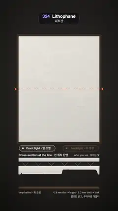

# 324 · Lithophane · 리토판



**EN** A blank white porcelain plate is lit from behind and a lighthouse glows out of its thickness; a cross-section shows thin parts bright, thick parts dark.  
**KO** 앞에서 비추면 빈 듯한 흰 자기판이 뒤에서 빛을 받자 두께 속에서 등대 풍경이 빛나 떠오르고, 단면도는 얇은 곳은 밝고 두꺼운 곳은 어둡다는 것을 보여 준다.

[Video (mp4)](https://sueun-dev.github.io/motion-effects/videos/324-lithophane.mp4) · [Code](../effects/324-lithophane.js) · Art & craft · 예술·공예

## Prompt (English)

```text
Create a "Lithophane" motion effect: a thin porcelain plate carved in relief on its back, nearly blank under front light, shows a picture only when a lamp behind it shines through, because thicker porcelain lets less light through.

Look
- A dark room: background mixing from (0.045, 0.042, 0.04) to (0.16, 0.15, 0.14) as the front light rises, with a soft vignette; when the lamp behind is on, a warm glow (1.0, 0.62, 0.3) × 0.28 leaks round the plate's edges, falling off as e^(−distance / 70 px).
- The plate: 740 × 960 px at (170, 330), in a slim 16 px walnut frame #3B2A1E.
- The carved picture (made once in grey, blurred 1.5 px): a lighthouse with dark bands and a lit lantern on a cliff, its beam reaching across the sky, a keeper's cottage, sun rays fanning from behind a cumulus, three clouds with bright tops, four gulls, a sea with a glitter path and wave lines, a sailboat, dark rocks with white spray in front, an oval vignette and the thick 36 px border lithophanes have.
- Thickness d = 0.8 + 2.2·(1 − L) mm for the picture's lightness L (0.8 mm where it is white, 3.0 mm where it is black). Light getting through: T = e^(−1.28·(d − 0.8)), from 1 down to 0.06.
- Backlit colour: (1.0, 0.78, 0.5) · T^0.9 · 1.08 + (0.03, 0.012, 0), read from L averaged over 13 taps (centre 0.2, twelve taps on a 3 px circle), because light scatters inside the porcelain.
- Front-lit colour: white porcelain (0.92, 0.91, 0.88) shaded gently across the plate, where the carving shows only as the faintest emboss (normal from the relief gradient × 0.5, light from (−0.45, 0.5, 0.74), mixed at 14 %).
- The cross-section line: a 3 px dashed orange line rgba(255, 120, 60, 0.95) across the plate with two small triangles #FF7A3C outside the frame.
- Two light pills in fixed places at y = 1322 (330 × 54 px, centred at x = 340 and 740): "Front light · 앞 조명" (#E8E4DA) and "Backlight · 뒤 조명" (#FFB866); the one that is on is at full strength, the other at 35 %.
- The cross-section (x 170–910): the title "Cross-section at the line · 선 위치 단면" and "what you see · 보이는 빛" at y = 1420; a 34 px strip (y 1436) of the colours along the line; the plate's profile with a flat front face at y = 1510 and its carved back drawn at 30 px per mm (24–90 px deep), filled porcelain and outlined in white; the lamp as a glowing bar at y = 1698; labels "lamp behind · 뒤 조명", "0.8 mm thin → bright · 3.0 mm thick → dark" and "얇으면 밝고, 두꺼우면 어둡다".

Motion (0–5 s)
- The lamp behind: b = smoothstep(0, 0.8, u) · (1 − smoothstep(2.5, 3.3, u)) with u = (t + 0.08) mod 5, so it fades on from 4.92 s to 0.72 s, stays on, and fades off over 2.42–3.22 s. The front light is 1 − 0.85·b. The plate shows white · front + backlit · b.
- The cross-section line sweeps down and back up: y = 330 + 960 · (0.5 + 0.36·sin(2πt / 5)). The strip, the profile and the rays follow its row every frame.
- Rays: when the lamp is on, vertical lines every 24 px rise from the lamp to the carved back (alpha 0.55·b) and continue above the front face toward the strip with alpha 0.9·b·T, so they thin out over the thick parts; when the front light is on, small white chevrons every 120 px bounce off the flat front face.

Technique
- A full-screen fragment shader reads the grey picture as a texture: it computes thickness, transmission and the scattered average per pixel, plus the weak front emboss from the picture's gradient.
- The cross-section and the labels are drawn on top in 2D from the same picture's pixels (read once), using the same formulas, so the diagram always matches the plate.
- The picture never changes; only the lamp, the line and the diagram move, smoothly.

Output and rules
- One self-contained HTML file with no external assets (three.js from a CDN is fine if you use it), drawing on a 1080 × 1920 canvas (9:16) scaled to fit the window.
- Write a function renderFrame(t) that draws the frame for time t in seconds, and preview it with requestAnimationFrame. Everything must be a pure function of t and fixed seeds: no Math.random(), Date or state carried between frames, so frame i = renderFrame(i / 30) can be exported to a 30 fps video.
- Loop seamlessly every 5 seconds: renderFrame(5) must look exactly like renderFrame(0).
- No flicker of any kind: no noise or grain that changes from frame to frame, no strobing or blinking, no z-fighting, no shimmering 1 px lines. Any grain or texture stays fixed to the screen or to the object.
- Keep the top 280 px free of important content (a title label goes there) and fill the whole frame with a designed background.
```

## 프롬프트 (한국어)

```text
"리토판" 모션 효과를 만들어 줘: 뒷면에 부조를 새긴 얇은 자기판은 앞에서 비추면 거의 빈 판이지만, 뒤에서 등이 비추면 두꺼운 곳일수록 빛이 덜 지나가서 그림이 나타난다.

모양
- 어두운 방: 배경은 앞 조명이 켜질수록 (0.045, 0.042, 0.04)에서 (0.16, 0.15, 0.14)로 바뀌고 부드러운 비네트가 있다. 뒤 등이 켜지면 따뜻한 빛 (1.0, 0.62, 0.3) × 0.28이 판 가장자리 둘레로 새어 나와 e^(−거리 / 70px)로 약해진다.
- 판: (170, 330)에 740 × 960px, 16px 호두나무 액자 #3B2A1E.
- 새긴 그림(회색으로 한 번 그리고 1.5px 흐림): 절벽 위 어두운 띠와 불 켜진 등롱의 등대와 하늘을 가로지르는 불빛, 등대지기 집, 뭉게구름 뒤에서 퍼지는 햇살, 윗면이 밝은 구름 셋, 갈매기 넷, 반짝이는 물길과 물결선의 바다, 돛단배, 앞쪽의 어두운 바위와 흰 물보라, 타원 비네트, 리토판 특유의 36px 두꺼운 테두리.
- 두께 d = 0.8 + 2.2·(1 − L) mm, L은 그림의 밝기(흰 곳 0.8 mm, 검은 곳 3.0 mm). 지나가는 빛: T = e^(−1.28·(d − 0.8)), 1에서 0.06까지.
- 뒤에서 비춘 색: (1.0, 0.78, 0.5) · T^0.9 · 1.08 + (0.03, 0.012, 0). 빛이 자기 안에서 퍼지므로 L은 13탭(가운데 0.2, 3px 원 위의 12탭)으로 평균한다.
- 앞에서 비춘 색: 판을 가로질러 은은하게 음영 진 흰 자기 (0.92, 0.91, 0.88). 새김은 아주 옅은 엠보스로만 보인다(부조 기울기 × 0.5로 만든 법선, (−0.45, 0.5, 0.74)에서 오는 빛, 14 % 섞음).
- 단면 선: 판을 가로지르는 3px 주황 점선 rgba(255, 120, 60, 0.95)과 액자 바깥의 작은 삼각형 둘 #FF7A3C.
- 고정 위치의 조명 알약 둘, y = 1322(330 × 54px, 중심 x = 340과 740): "Front light · 앞 조명"(#E8E4DA)과 "Backlight · 뒤 조명"(#FFB866). 켜진 쪽은 100 %, 다른 쪽은 35 %.
- 단면도(x 170–910): y = 1420에 제목 "Cross-section at the line · 선 위치 단면"과 "what you see · 보이는 빛"; 선을 따라 보이는 색의 34px 띠(y 1436); 앞면은 y = 1510에서 평평하고 새긴 뒷면은 1 mm당 30px(깊이 24–90px)로 그린 판의 옆모습, 자기색으로 채우고 흰 외곽선; y = 1698의 빛나는 막대로 그린 등; 라벨 "lamp behind · 뒤 조명", "0.8 mm thin → bright · 3.0 mm thick → dark", "얇으면 밝고, 두꺼우면 어둡다".

움직임 (0–5초)
- 뒤 등: b = smoothstep(0, 0.8, u) · (1 − smoothstep(2.5, 3.3, u)), u = (t + 0.08) mod 5. 4.92초에서 0.72초에 걸쳐 켜지고, 켜진 채로 있다가, 2.42–3.22초에 꺼진다. 앞 조명은 1 − 0.85·b. 판은 흰색 · 앞 조명 + 투과색 · b로 보인다.
- 단면 선이 아래로 내려갔다 다시 올라온다: y = 330 + 960 · (0.5 + 0.36·sin(2πt / 5)). 띠·옆모습·빛살이 매 프레임 그 줄을 따른다.
- 빛살: 등이 켜지면 24px마다 세로선이 등에서 새긴 뒷면까지 올라가고(알파 0.55·b), 앞면 위로는 알파 0.9·b·T로 띠를 향해 이어져 두꺼운 곳에서 가늘어진다. 앞 조명이 켜지면 120px마다 작은 흰 꺾쇠가 평평한 앞면에서 튕긴다.

기법
- 화면 전체 프래그먼트 셰이더가 회색 그림을 텍스처로 읽어 픽셀마다 두께·투과율·퍼짐 평균과, 그림 기울기로 만든 약한 앞면 엠보스를 계산한다.
- 단면도와 라벨은 같은 그림의 픽셀(한 번 읽어 둔)로 같은 식을 써서 2D로 위에 그리므로 도식이 늘 판과 맞는다.
- 그림은 바뀌지 않고, 등·선·도식만 매끄럽게 움직인다.

출력과 규칙
- 외부 파일 없는 HTML 파일 하나(three.js를 쓴다면 CDN은 괜찮다). 1080 × 1920(9:16) 캔버스에 그리고 창 크기에 맞춰 보이게 한다.
- 시간 t(초)의 프레임을 그리는 renderFrame(t) 함수를 만들고, 미리보기는 requestAnimationFrame으로 돌린다. 모든 것은 t와 고정 시드만으로 정해진다: Math.random(), Date, 프레임 사이에 쌓이는 상태 금지. 그래야 i번째 프레임 = renderFrame(i / 30)으로 30fps 영상을 뽑을 수 있다.
- 5초마다 끊김 없이 반복: renderFrame(5)는 renderFrame(0)과 똑같아 보여야 한다.
- 어떤 깜빡임도 금지: 프레임마다 바뀌는 노이즈·그레인, 번쩍임·깜빡임, z-fighting, 반짝이며 떨리는 1px 선 모두 금지. 그레인·질감은 화면이나 물체에 고정한다.
- 위쪽 280px에는 중요한 내용을 두지 않고(제목 라벨 자리), 화면 전체를 디자인된 배경으로 채운다.
```
