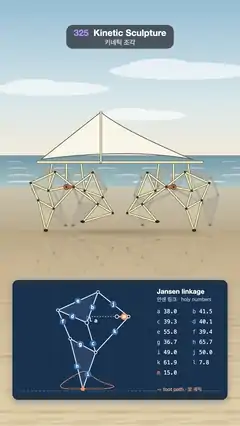

# 325 · Kinetic Sculpture · 키네틱 조각



**EN** A beach walker on Jansen's linkage strides along wet sand on eight legs driven by two orange cranks, above a blueprint of one leg with its holy numbers.  
**KO** 얀센 링크로 움직이는 해변 보행 조각이 주황 크랭크 둘로 다리 여덟 개를 굴려 젖은 모래 위를 걷고, 아래 청사진은 다리 하나와 그 '성스러운 수'를 보여 준다.

[Video (mp4)](https://sueun-dev.github.io/motion-effects/videos/325-kinetic-sculpture.mp4) · [Code](../effects/325-kinetic-sculpture.js) · Art & craft · 예술·공예

## Prompt (English)

```text
Create a "Kinetic Sculpture" motion effect: a wind-walker sculpture of plastic tubes that walks on Theo Jansen's linkage, where turning one crank makes each foot trace a flat-bottomed path, with a blueprint that shows how one leg works.

Look
- Canvas 2D, side view. Linkage units (Jansen's "holy numbers"): a 38, b 41.5, c 39.3, d 40.1, e 55.8, f 39.4, g 36.7, h 65.7, i 49, j 50, k 61.9, l 7.8, m 15.
- One leg at crank angle θ (y up, crank axle O at the origin): fixed pivot X = (−38, −7.8); crank pin A = 15·(cos θ, sin θ); B is the upper point at j = 50 from A and b = 41.5 from X; C is the lower point at k = 61.9 from A and c = 39.3 from X; D is the left point at e = 55.8 from B and d = 40.1 from X; E is the left point at f = 39.4 from D and g = 36.7 from C; the foot F is the lower point at h = 65.7 from E and i = 49 from C. Triangles X-B-D and C-E-F are rigid and filled pale. The mirror leg on the same crank pin is the leg at π − θ with x flipped.
- The walker (2.15 px per unit, feet on a ground line at y = 1040, the foot's lowest point 91.83 below the axle): two crank modules at x = ±112 units, each with a leg reaching back and a mirrored leg reaching forward; the second module is half a turn behind the first. The far-side legs are a quarter turn later, drawn 6 units right and 9 up in grey #B9B6A6.
- Tubes: cream #F2E7BE, 6.5 px wide with a 3.5 px darker edge #5E5136; joints as 5.5 px dark dots #3A342B; small rubber feet. Each crank is an orange disc #E0703A with a 9 px arm. A frame of tubes: a backbone 52 units above the axles from −172 to 172, braced down to each axle and its two fixed pivots; a mast at x = −40 rising 105 units above the backbone carrying a cream triangular sail.
- The beach: sky #93BCD6 → #D8E6EA (65 %) → #F3EBDB, three flat soft clouds, a sea band #6F95A8 → #A7C1C6 from y = 700 to 840 with four white surf lines, wet sand #C9C3B0 → #BBA98A down to the ground line, then a foreground sand strip (#B9A584 → #CDB894 → #E2CFA9) with soft ripples and streaks. The walker is mirrored in the wet sand at 18 % (fading toward the blueprint) and sits on a soft flat shadow 960 px wide.
- The blueprint card: x 56, y 1262, 968 × 540 px, navy #16304F with a 28 px grid, a soft drop shadow. One leg (the back-reaching leg of the first module) at 3.55 px per unit, crank axle at (526, 1427): white 4 px bars, the crank m in orange 7 px, the frame bars a and l dashed, joints as rings, the foot as an orange dot, and the foot's whole path as a 3 px orange outline. Each bar carries its letter in a 15 px blue disc at a fixed fraction of its length (m 0.62, j 0.5, b 0.5, k 0.42, c 0.7, e 0.5, d 0.5, f 0.4, g 0.6, h 0.55, i 0.6), checked so no two letters ever overlap. On the right: "Jansen linkage", "얀센 링크 · holy numbers", the thirteen lengths in two columns, and "— foot path · 발 궤적".

Motion (0–5 s)
- The crank turns twice per loop: θ = −2π · 2 · t / 5 (this direction makes the feet push backwards, so the walker walks right). Every joint is recomputed from θ each frame by intersecting two circles.
- Walking speed is the feet's mean speed on the flat bottom of their path (within 1 unit of the lowest point): 21.2 units per radian, about 573 px per loop. The foreground sand slides at that speed and repeats every half of that distance, so it loops.
- The sail breathes with the crank (its belly moves 4·sin 2θ units). The surf lines slide slowly, each exactly one of its own repeats per loop (periods 160, 200, 240, 280 px).
- The blueprint leg and its foot dot turn with the first module's crank.

Technique
- Circle-circle intersection for each joint, choosing the upper, lower or left solution as listed; nothing is simulated, every frame is a pure function of θ.
- The sky, sea and wet sand are drawn once; the sand strip is drawn once, wider than the frame by one repeat, and shifted.
- The bar letters are placed at fixed fractions found by checking their distances over the whole loop.

Output and rules
- One self-contained HTML file with no external assets (three.js from a CDN is fine if you use it), drawing on a 1080 × 1920 canvas (9:16) scaled to fit the window.
- Write a function renderFrame(t) that draws the frame for time t in seconds, and preview it with requestAnimationFrame. Everything must be a pure function of t and fixed seeds: no Math.random(), Date or state carried between frames, so frame i = renderFrame(i / 30) can be exported to a 30 fps video.
- Loop seamlessly every 5 seconds: renderFrame(5) must look exactly like renderFrame(0).
- No flicker of any kind: no noise or grain that changes from frame to frame, no strobing or blinking, no z-fighting, no shimmering 1 px lines. Any grain or texture stays fixed to the screen or to the object.
- Keep the top 280 px free of important content (a title label goes there) and fill the whole frame with a designed background.
```

## 프롬프트 (한국어)

```text
"키네틱 조각" 모션 효과를 만들어 줘: 플라스틱 관으로 만든 바람 보행 조각이 테오 얀센의 링크로 걷는다. 크랭크 하나만 돌려도 발이 바닥이 평평한 궤적을 그리고, 아래 청사진이 다리 하나가 어떻게 움직이는지 보여 준다.

모양
- 캔버스 2D, 옆에서 본 모습. 링크 길이(얀센의 '성스러운 수'): a 38, b 41.5, c 39.3, d 40.1, e 55.8, f 39.4, g 36.7, h 65.7, i 49, j 50, k 61.9, l 7.8, m 15.
- 크랭크 각 θ의 다리 하나(y 위쪽, 크랭크 축 O가 원점): 고정 피벗 X = (−38, −7.8); 크랭크 핀 A = 15·(cos θ, sin θ); B는 A에서 j = 50, X에서 b = 41.5인 위쪽 점; C는 A에서 k = 61.9, X에서 c = 39.3인 아래쪽 점; D는 B에서 e = 55.8, X에서 d = 40.1인 왼쪽 점; E는 D에서 f = 39.4, C에서 g = 36.7인 왼쪽 점; 발 F는 E에서 h = 65.7, C에서 i = 49인 아래쪽 점. 삼각형 X-B-D와 C-E-F는 고정 삼각형이라 옅게 채운다. 같은 크랭크 핀의 거울 다리는 π − θ의 다리를 좌우로 뒤집은 것.
- 보행 조각(1 단위 = 2.15px, 발은 y = 1040의 땅선, 발의 가장 낮은 점은 축 아래 91.83): x = ±112 단위에 크랭크 모듈 둘, 모듈마다 뒤로 뻗은 다리와 앞으로 뻗은 거울 다리; 둘째 모듈은 첫째보다 반 바퀴 늦다. 먼 쪽 다리는 4분의 1바퀴 늦고, 오른쪽으로 6, 위로 9 단위 옮겨 회색 #B9B6A6으로 그린다.
- 관: 크림색 #F2E7BE, 폭 6.5px에 3.5px 어두운 테두리 #5E5136; 관절은 5.5px 어두운 점 #3A342B; 작은 고무 발. 크랭크마다 주황 원판 #E0703A와 9px 팔. 관 뼈대: 축보다 52 단위 위의 등뼈(−172에서 172), 각 축과 두 고정 피벗으로 내려간 버팀대; x = −40에서 등뼈 위로 105 단위 솟은 돛대에 크림색 삼각 돛.
- 해변: 하늘 #93BCD6 → #D8E6EA(65 %) → #F3EBDB, 납작하고 부드러운 구름 셋, y = 700–840의 바다 띠 #6F95A8 → #A7C1C6과 흰 파도선 넷, 땅선까지 젖은 모래 #C9C3B0 → #BBA98A, 그 아래 잔물결과 줄무늬가 있는 앞쪽 모래 띠(#B9A584 → #CDB894 → #E2CFA9). 보행 조각은 젖은 모래에 18 %로 비치고(청사진 쪽으로 옅어짐) 폭 960px의 납작한 그림자 위에 선다.
- 청사진 카드: x 56, y 1262, 968 × 540px, 남색 #16304F, 28px 격자, 부드러운 그림자. 다리 하나(첫 모듈의 뒤로 뻗은 다리)를 1 단위 3.55px로, 크랭크 축은 (526, 1427): 흰 4px 막대, 크랭크 m은 7px 주황, 뼈대 막대 a와 l은 점선, 관절은 고리, 발은 주황 점, 발의 전체 궤적은 3px 주황 외곽선. 막대마다 길이의 정해진 비율(m 0.62, j 0.5, b 0.5, k 0.42, c 0.7, e 0.5, d 0.5, f 0.4, g 0.6, h 0.55, i 0.6) 위치에 15px 파란 원 안의 글자를 붙이는데, 루프 내내 두 글자가 겹치지 않음을 확인한 값이다. 오른쪽에 "Jansen linkage", "얀센 링크 · holy numbers", 열세 길이를 두 줄로, "— foot path · 발 궤적".

움직임 (0–5초)
- 크랭크는 한 루프에 두 바퀴: θ = −2π · 2 · t / 5(이 방향이면 발이 뒤로 밀어 조각이 오른쪽으로 걷는다). 관절은 매 프레임 θ에서 원 두 개의 교점으로 다시 구한다.
- 걷는 속도는 발 궤적의 평평한 바닥(가장 낮은 점에서 1 단위 이내)에서 발의 평균 속도: 라디안당 21.2 단위, 한 루프에 약 573px. 앞쪽 모래가 그 속도로 미끄러지고 그 거리의 절반마다 반복되어 루프가 맞는다.
- 돛은 크랭크에 맞춰 숨 쉰다(배가 4·sin 2θ 단위 움직인다). 파도선은 천천히 미끄러지며, 각자 한 루프에 자기 반복 하나씩(주기 160, 200, 240, 280px) 움직인다.
- 청사진의 다리와 발 점은 첫 모듈의 크랭크와 함께 돈다.

기법
- 관절마다 원-원 교점을 구하고 위 목록대로 위·아래·왼쪽 해를 고른다. 시뮬레이션 없이 모든 프레임이 θ의 순수 함수다.
- 하늘·바다·젖은 모래는 한 번 그리고, 모래 띠도 화면보다 반복 하나만큼 넓게 한 번 그려 옮겨 쓴다.
- 막대 글자 위치는 루프 전체에서 거리를 확인해 찾은 고정 비율이다.

출력과 규칙
- 외부 파일 없는 HTML 파일 하나(three.js를 쓴다면 CDN은 괜찮다). 1080 × 1920(9:16) 캔버스에 그리고 창 크기에 맞춰 보이게 한다.
- 시간 t(초)의 프레임을 그리는 renderFrame(t) 함수를 만들고, 미리보기는 requestAnimationFrame으로 돌린다. 모든 것은 t와 고정 시드만으로 정해진다: Math.random(), Date, 프레임 사이에 쌓이는 상태 금지. 그래야 i번째 프레임 = renderFrame(i / 30)으로 30fps 영상을 뽑을 수 있다.
- 5초마다 끊김 없이 반복: renderFrame(5)는 renderFrame(0)과 똑같아 보여야 한다.
- 어떤 깜빡임도 금지: 프레임마다 바뀌는 노이즈·그레인, 번쩍임·깜빡임, z-fighting, 반짝이며 떨리는 1px 선 모두 금지. 그레인·질감은 화면이나 물체에 고정한다.
- 위쪽 280px에는 중요한 내용을 두지 않고(제목 라벨 자리), 화면 전체를 디자인된 배경으로 채운다.
```
